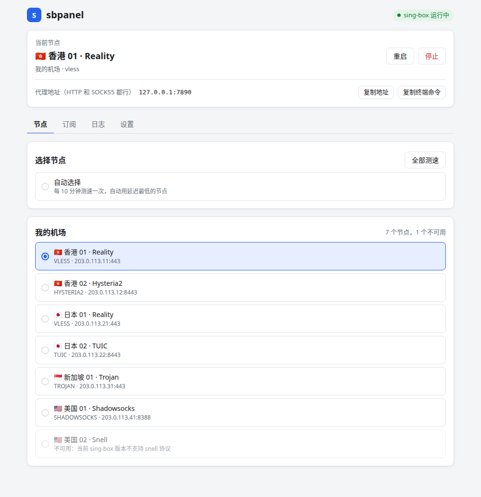
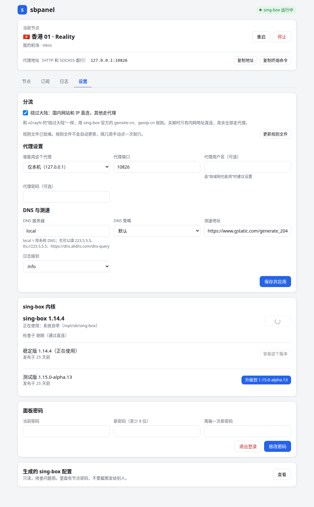

# sbpanel

[](https://github.com/xxddccaa/sbpanel/actions/workflows/ci.yml)
[](https://github.com/xxddccaa/sbpanel/releases)
[](LICENSE)

在**没有桌面的 Linux 服务器**上，用浏览器管理 [sing-box](https://github.com/SagerNet/sing-box) 订阅。

v2rayN 这类客户端需要图形界面。sbpanel 把它们最常用的几项操作做成了网页：添加订阅、选节点、测速、绕过大陆、启动和停止代理。装在服务器上以后，用自己电脑或手机的浏览器操作。

<p align="center">
  
  
</p>

- **一个可执行文件**：Go 编写，只用标准库，网页打包在程序里，没有其他依赖
- **一行命令安装**：有 systemd 就注册成服务并开机自启；容器、Kubernetes、没有 root 的环境也能装，改用后台进程运行；没装 sing-box 的话顺便装上
- **终端里也能管**：`sbpanel` 打开管理菜单，可以查看状态、启停服务、看日志、更新、卸载

## 安装

```bash
bash <(curl -fsSL https://raw.githubusercontent.com/xxddccaa/sbpanel/main/install.sh)
```

安装完会打印面板地址，浏览器直接打开就能用，不需要密码：

```
✓ sbpanel v0.2.0 已安装并启动
  运行方式  systemd 服务
  网页面板  http://192.168.1.10:8091
  访问方式  免密码，直接打开（仅限可信网络，勿直接暴露到公网）
  管理命令  sbpanel（打开管理菜单）
  开机自启  已开启
```

安装方式会根据环境自动选择，不需要加任何参数：

| 环境 | 安装位置 | 运行方式 | 开机自启 |
|------|----------|----------|----------|
| root，有 systemd | `/usr/local/bin`、`/var/lib/sbpanel` | systemd 服务 | 有 |
| root，没有 systemd（Docker、Kubernetes 等容器） | 同上 | 后台进程 | 没有，重启后运行 `sbpanel start` |
| 普通用户，或者系统目录只读 | `~/.local/bin`、`~/.local/share/sbpanel` | 后台进程 | 没有，重启后运行 `sbpanel start` |

- systemd 存在但启动服务失败时，也会自动改用后台进程，安装不会因此失败；问题解决后再运行一次安装就会换回 systemd。
- 在容器里想让它随容器一起启动：把 `sbpanel start` 加到容器的启动脚本里，或者让容器、supervisord 直接运行 `sbpanel serve`。
- 支持 x86_64、arm64、armv7、i386。
- 服务器访问不了 GitHub 时，可以加一个加速前缀：`GH_PROXY=https://ghfast.top/ bash <(curl -fsSL https://ghfast.top/https://raw.githubusercontent.com/xxddccaa/sbpanel/main/install.sh)`。也可以设置 `HTTPS_PROXY`。
- 换面板端口：在命令末尾加 `--port 8092`。只允许本机访问：加 `--listen 127.0.0.1:8091`。
- 下载的文件都会按 `sha256sums.txt` 校验。sing-box 安装包按 GitHub 提供的 SHA-256 校验。

## 使用

1. 浏览器打开安装时打印的面板地址。
2. **订阅** → **添加订阅**，粘贴订阅地址。
3. 点 **启动代理**。
4. **节点** 页：点一下切换节点，或者选“自动选择”，也可以全部测速。
5. 让服务器上的程序走代理。状态卡片上的“复制终端命令”会生成这一行：

   ```bash
   export http_proxy=http://127.0.0.1:10826 https_proxy=http://127.0.0.1:10826 all_proxy=socks5h://127.0.0.1:10826
   ```

代理端口默认 `127.0.0.1:10826`，同时支持 HTTP 和 SOCKS5。在“设置”里可以改端口，也可以开放给局域网，开放时建议设置用户名和密码。

### 绕过大陆

在“设置”里勾上 **绕过大陆**：国内域名（geosite-cn）和国内 IP（geoip-cn）直连，其余走代理，和 v2rayN 的同名选项一样。

- 规则文件来自 sing-box 官方的 [sing-geosite](https://github.com/SagerNet/sing-geosite) 和 [sing-geoip](https://github.com/SagerNet/sing-geoip)，总共约 100 KB。第一次打开开关时下载，之后只在你点“更新规则文件”时更新。最好先启动代理再打开这个开关，这样规则文件可以通过代理下载。
- 判断一个域名是不是国内的，靠的是域名规则，不会先在本地把域名解析一遍，所以国外域名不会泄露给本地 DNS。
- 打开后，`www.gstatic.com` 这类在国内也有服务的域名会走直连。想测试代理是否可用，请换成 `https://cp.cloudflare.com/` 之类的地址。

### 订阅更新

- **默认只手动更新**。按固定时间拉订阅是一种可以被识别的规律，而且订阅地址里带着账号密钥。
- 可以给单个订阅打开自动更新。实际时间会在设定间隔的基础上随机推迟 0～25%。
- 更新时优先走已经启动的代理（请求加密），代理不通再直连。也可以设成“只走代理”或“只直连”。
- 更新失败时保留原来的节点。错误信息里不会出现订阅地址。

### sing-box 内核

“设置 → sing-box 内核”可以检查新版本（只在你点的时候访问 GitHub），一键安装稳定版或测试版：

1. 下载官方安装包，按 SHA-256 校验
2. 先用新版本检查一遍当前配置，通过了才切换
3. 切换后启动失败，自动换回原来的版本

面板安装的内核放在 `/var/lib/sbpanel/kernel/`，不会改动系统里的 sing-box。随时可以回退到上一个版本，或改回系统自带的版本。

### 升级 sbpanel

“设置 → sbpanel 版本”可以检查和安装新版本，不用登录服务器：

1. 只在你点“检查更新”时访问 GitHub。**优先通过已经启动的代理下载**，代理不通再直连，所以服务器直连不了 GitHub 也能升级
2. 下载官方发布包，按 SHA-256 校验
3. 面板自动重启到新版本，代理会中断几秒钟。新版本 90 秒内没有正常启动，会自动换回原来的版本，并在网页上显示原因
4. 随时可以点“回退”换回上一个版本

原理：面板服务不能改写 `/usr/local/bin/sbpanel`（systemd 下它以临时用户运行，系统目录只读）。所以 `sbpanel serve` 是一个很小的主进程，真正的面板是它的子进程。网页里下载的新版本放在数据目录的 `panel/` 下，主进程发现它比自己新，就改为运行它。以后用 `sbpanel update` 装了更新的版本，会自动改用那个。

这个功能从 v0.3.0 开始有。还在用 v0.2.x 的，先在服务器上运行一次 `sbpanel update`。

<p align="center"></p>

## 终端管理

直接运行 `sbpanel` 会打开管理菜单：

```
  sbpanel 管理菜单  v0.2.0
  ─────────────────────────────────
  服务: ● 运行中（已运行 3 小时，内存 45 MB）
  运行方式: systemd 服务   开机自启: 已开启
  面板: http://192.168.1.10:8091

   1. 查看详细状态
   2. 启动              3. 停止              4. 重启
   5. 关闭开机自启
   6. 查看最近日志      7. 持续查看日志（Ctrl+C 返回）
   8. 修改面板地址/端口
   9. 更新 sbpanel
  10. 卸载
   0. 退出
```

也可以直接用子命令：

| 命令 | 作用 |
|------|------|
| `sbpanel status` | 服务状态、面板地址、sing-box 版本、当前节点，并实际测一次代理是否可用 |
| `sbpanel url` | 只打印当前网页面板地址并立刻退出（不进管理菜单） |
| `sbpanel open` | 在桌面环境直接用浏览器打开面板；无桌面服务器环境则打印面板地址 |
| `sbpanel start` / `stop` / `restart` | 启动、停止、重启（停止时代理也会一起停） |
| `sbpanel enable` / `disable` | 开启、关闭开机自启（只有 systemd 服务方式支持） |
| `sbpanel logs [-f]` | 查看日志，`-f` 持续输出（systemd 方式读 journald，后台进程方式读日志文件） |
| `sbpanel listen 127.0.0.1:8091` | 修改面板监听地址；只写端口也行，比如 `sbpanel listen 8092` |
| `sbpanel update` | 更新到最新版本（也可以在网页面板里升级，见下文） |
| `sbpanel uninstall [--purge]` | 卸载；默认保留订阅和设置，重新安装后继续使用；加 `--purge` 一起删除 |

`sbpanel status` 的输出示例：

```
sbpanel v0.2.0
  服务      ● 运行中（已运行 3 小时，内存 45 MB）
  运行方式  systemd 服务
  开机自启  已开启
  网页面板  http://192.168.1.10:8091
  sing-box  1.14.4 （系统 /usr/local/bin/sing-box）
  代理      127.0.0.1:10826  HTTP 和 SOCKS5 都行
  绕过大陆  开
  订阅      1 个，共 7 个节点
  当前节点  🇭🇰 香港 01 · Reality（手动选择）
  连通性    ✓ 代理可用（cp.cloudflare.com 312 ms）
```

## 安全

- **面板没有密码**，能访问面板端口的人都能操作它（包括看到订阅地址和节点密码）。只在可信的局域网里开放，或者按下面的方法只监听本机。
- 修改类请求有 CSRF 防护，跨站请求会被拒绝。
- 防 DNS 重绑定：只接受用 IP 地址或 `localhost` 打开面板。用域名访问（比如前面加了反向代理）时，在 `sbpanel.env` 里加上 `SBPANEL_ALLOWED_HOSTS=panel.example.com`（多个用逗号分隔），然后 `sbpanel restart`。
- 用 systemd 运行时，服务以临时用户（`DynamicUser`）身份运行，不需要 root，也不能改动系统文件。少数系统不支持这些沙箱选项，会自动改用普通的 systemd 服务。
- **面板走的是明文 HTTP。** 默认监听 `0.0.0.0:8091`，方便在局域网里用。在公网服务器上，建议只监听本机，再用 SSH 隧道访问：

  ```bash
  sbpanel listen 127.0.0.1:8091
  # 在你自己的电脑上：
  ssh -L 8091:127.0.0.1:8091 root@服务器
  # 然后浏览器打开 http://127.0.0.1:8091
  ```

  也可以在前面加一层带认证的 HTTPS 反向代理（nginx、Caddy），记得把域名加到 `SBPANEL_ALLOWED_HOSTS`。

## 目前的限制

- **只支持 sing-box JSON 格式的订阅**，base64 编码过的也可以。
  - [fscarmen/sing-box](https://github.com/fscarmen/sing-box) 脚本的订阅：用 `http://服务器:端口/UUID/sing-box` 这个地址。
  - Clash YAML 和 `vless://` 这类分享链接格式的订阅会提示“暂不支持”，在[计划](ROADMAP.md)里。
- 只提供本地代理（HTTP + SOCKS5），没有 TUN 透明代理。
- 分流只有两种：“内网直连，其余走代理”，或者再加上“绕过大陆”。还不能自定义规则。
- 当前 sing-box 不支持的节点（比如官方版本没有的 snell）会单独标成“不可用”，不影响其他节点。

## 文件位置

| root 安装 | 普通用户安装 | 内容 |
|-----------|--------------|------|
| `/usr/local/bin/sbpanel` | `~/.local/bin/sbpanel` | 程序（安装时下载的 sing-box 也放在这里） |
| `/etc/sbpanel/sbpanel.env` | `~/.config/sbpanel/sbpanel.env` | 服务设置（面板监听地址等） |
| `/var/lib/sbpanel/` | `~/.local/share/sbpanel/` | 订阅、设置、生成的 sing-box 配置、规则文件、面板安装的内核和 sbpanel |
| journald | `~/.local/share/sbpanel/sbpanel.log` | 日志（root 用后台进程方式时在 `/var/log/sbpanel/sbpanel.log`） |
| `/etc/systemd/system/sbpanel.service` | — | systemd 服务（只有 systemd 方式才有） |

## 从源码构建

需要 Go 1.22 或更新版本。

```bash
git clone https://github.com/xxddccaa/sbpanel.git
cd sbpanel
make test        # 测试
make build       # 编译当前平台
make run         # 用 ./dev-data 在 127.0.0.1:8091 运行
make install     # 编译并安装成本机服务（需要 sudo）
make dist        # 交叉编译所有架构，输出到 dist/
```

代码结构：

| 文件 | 内容 |
|------|------|
| `main.go` | 命令行入口、`serve` |
| `manage.go` | 终端管理：状态、启停、日志、菜单 |
| `install.go` | 安装、更新、卸载 |
| `service.go` | 运行方式：systemd 服务或后台进程，自动选择 |
| `app.go` | 业务逻辑：订阅、选节点、测速、设置，以及失败回滚 |
| `config.go` | 生成 sing-box 配置，用 `sing-box check` 校验并剔除不支持的节点 |
| `subscription.go` | 下载订阅、识别格式、提取节点 |
| `rules.go` | “绕过大陆”的规则文件 |
| `kernel.go` | sing-box 内核：查版本、下载校验、切换、回退 |
| `core.go` | sing-box 子进程管理、日志缓冲、clash API |
| `panel.go` | 在网页里升级 sbpanel：主进程（守护）与面板子进程、下载校验、试运行和回退 |
| `server.go` | HTTP 接口 |
| `store.go` | 状态保存（原子写入） |
| `transfer.go` | 下载工具：先走代理再直连 |
| `web/` | 前端（原生 JS，不需要构建） |

发布：推送 `v*` 标签后，GitHub Actions 会自动交叉编译并发布 Release。

## 许可证

[MIT](LICENSE)

sbpanel 会把 sing-box 作为独立程序调用和下载，但不包含 sing-box 的代码。sing-box 使用 GPL-3.0 许可证。
